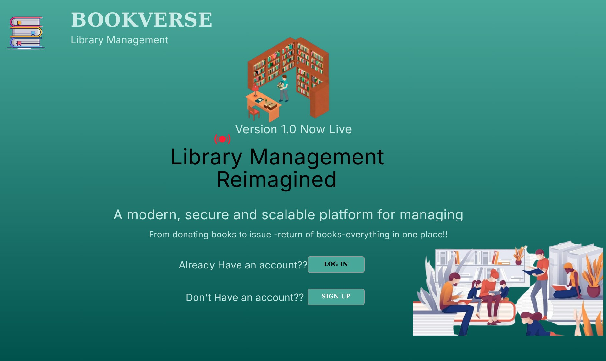

# BookVerse

**Library management, reimagined.**

A JavaFX desktop app that runs a small library end to end: catalogue, members,
issuing, returns, fines and a community chat. Everything is saved to plain-text
files, so there is nothing to install but Java.

[Screens](#screens) ·
[Flows](#flows) ·
[Architecture](#architecture) ·
[Get started](#getting-started)

