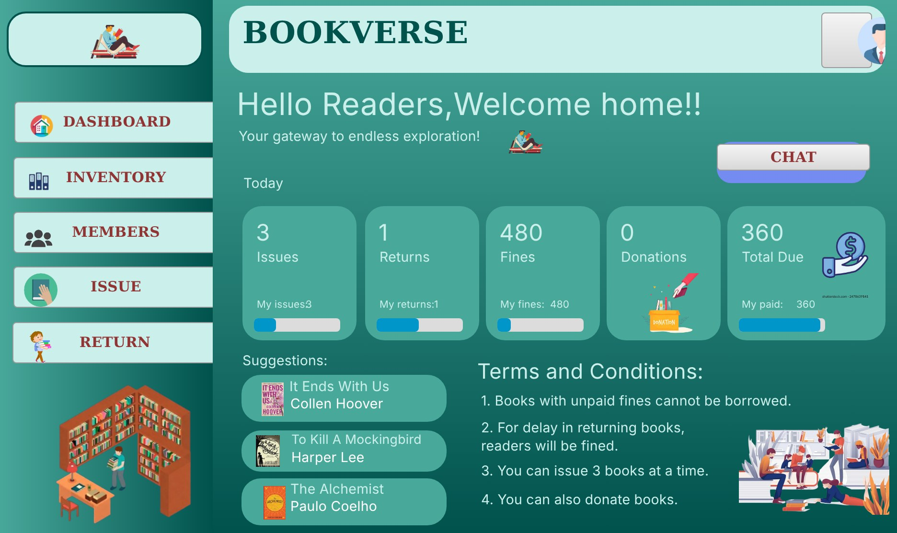
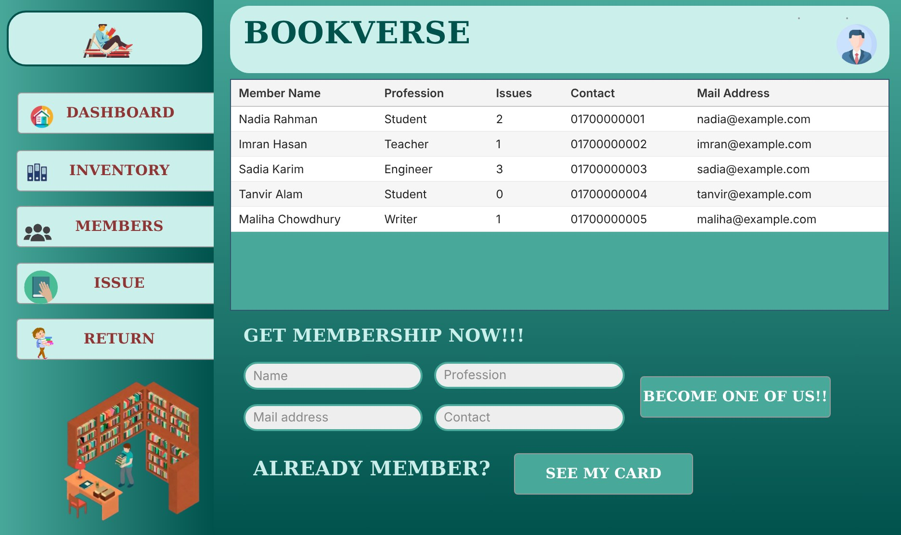

# BookVerse

**Library management, reimagined.**

A JavaFX desktop app that runs a small library end to end: catalogue, members,
issuing, returns, fines and a community chat. Everything is saved to plain-text
files, so there is nothing to install but Java.

[Screens](#screens) ·
[Flows](#flows) ·
[Architecture](#architecture) ·
[Get started](#getting-started)

BookVerse covers the daily work of a small library. A librarian keeps the
catalogue and the member list, readers borrow up to three books at a time, and
late returns are fined at a fixed daily rate that stops growing once the book is
back. A built-in chat room lets members talk to each other. The whole thing is
about 1,400 lines of Java plus FXML views and one stylesheet.

## At a glance

| | |
| --- | --- |
| **What it is** | A desktop app built with Java 21, JavaFX 21.0.6 and Gradle 8.13 |
| **Storage** | Three plain-text files, `library_data.txt`, `members.txt` and `user_data.txt`; no database |
| **Borrowing rules** | At most 3 books out per member, and no new issue while the total due is above 1000 TK |
| **Fines** | 60 TK per overdue day; the fine freezes on return and can be paid in part or in full, never over |
| **Chat** | A socket chat server on port 12345 with one handler thread per client |
| **Screens** | Welcome, dashboard, inventory, issue, return, members, chat and pop-ups for login, sign-up and cards |
| **Licence** | MIT |

## Screens

These are **layout previews rendered from the app's own FXML views and `style.css`**
with invented sample data, not JavaFX screenshots. A small script,
[`docs/tools/render_previews.py`](./docs/tools/render_previews.py), positions each FXML
node in HTML and maps the `-fx-*` styles to CSS, so you can regenerate them.
Fonts and small details differ from the real window, and the books, members and
numbers shown are made up.

<table>
<tr>
<td width="50%" valign="top">

<b>Dashboard.</b> Counters for issues, returns, fines, donations and dues with progress bars, three suggestions and the library terms.

</td>
<td width="50%" valign="top">

<b>Inventory.</b> The whole catalogue in one table, with a row underneath to add a book.

</td>
</tr>
<tr>
<td width="50%" valign="top">

<b>Issue.</b> Filter by author, title or availability, search, then issue a book against a due date.

</td>
<td width="50%" valign="top">

<b>Return and pay.</b> Return an issued book, and settle any fine from the table underneath.

</td>
</tr>
<tr>
<td width="50%" valign="top">

<b>Members.</b> The member list, a form to become a member and a button to view your card.

</td>
<td width="50%" valign="top">

<b>Welcome.</b> The first screen: log in or sign up from here.

</td>
</tr>
</table>
