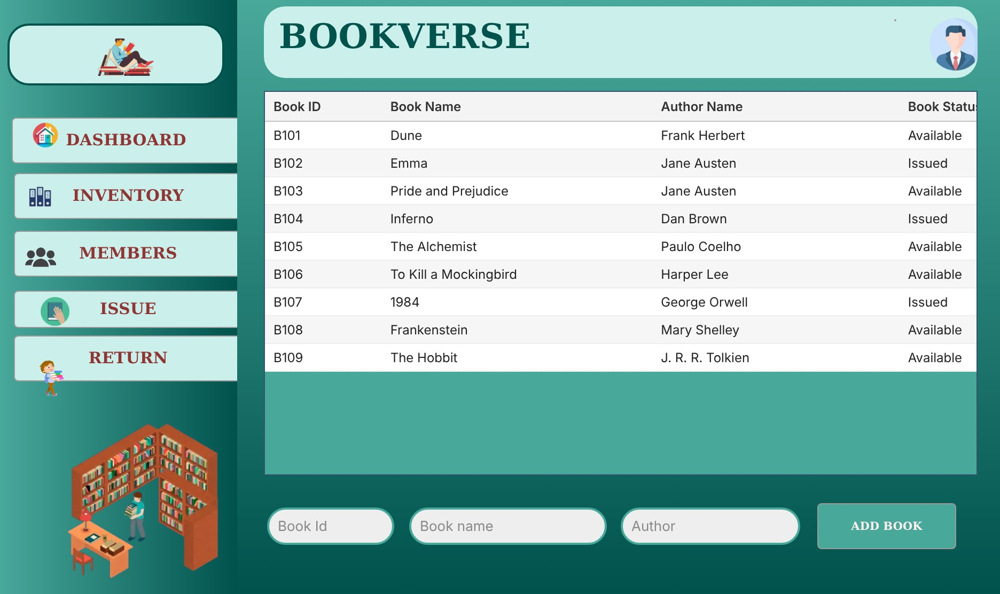
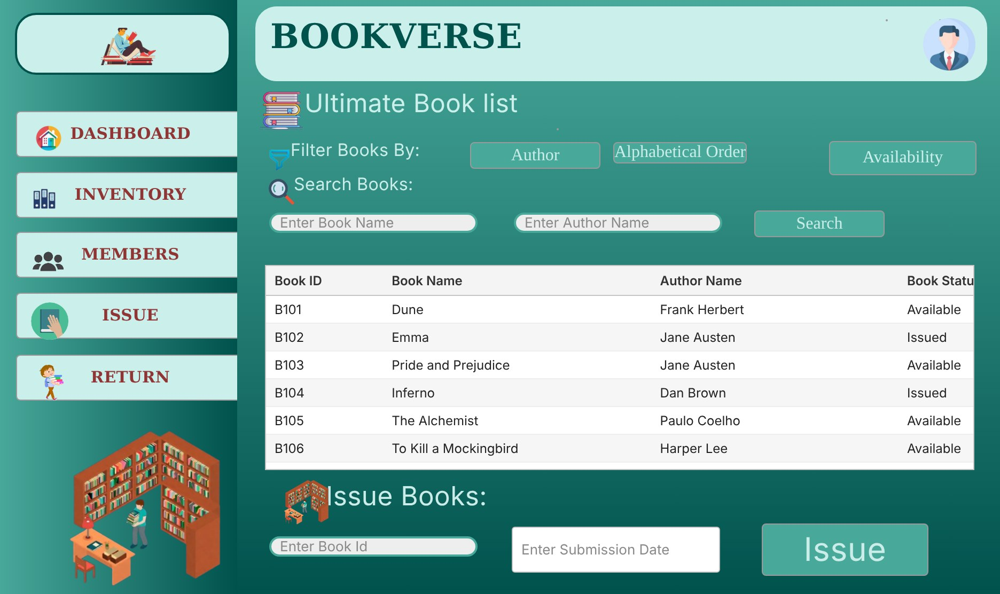
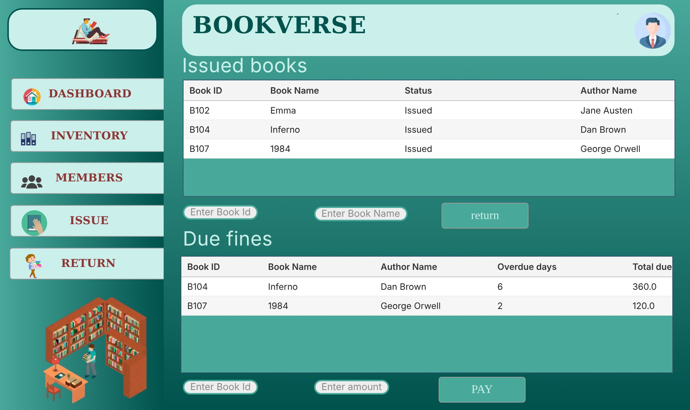
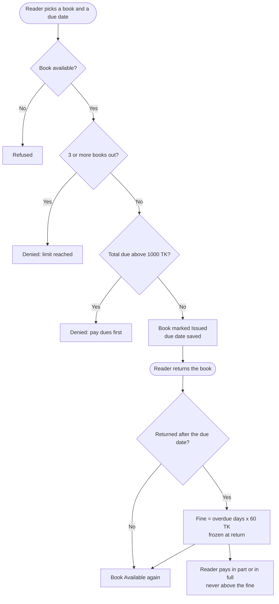
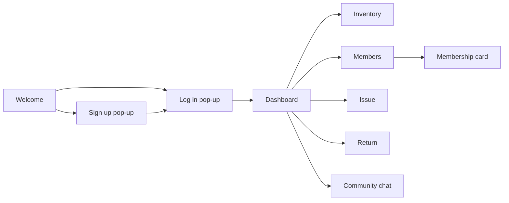
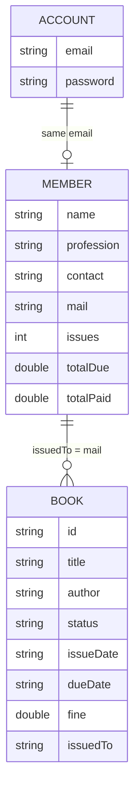
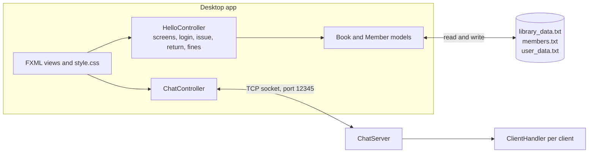

<div align="center">


# BookVerse

**Library management, reimagined.**

A JavaFX desktop app that runs a small library end to end: catalogue, members,
issuing, returns, fines and a community chat. Everything is saved to plain-text
files, so there is nothing to install but Java.


[Screens](#screens) ·
[Flows](#flows) ·
[Architecture](#architecture) ·
[Get started](#getting-started)


</div>

BookVerse covers the daily work of a small library. A librarian keeps the
catalogue and the member list, readers borrow up to three books at a time, and
late returns are fined at a fixed daily rate that stops growing once the book is
back. A built-in chat room lets members talk to each other. The whole thing is
about 1,400 lines of Java plus FXML views and one stylesheet.

## At a glance

| | |
| --- | --- |
| **What it is** | A desktop app built with Java 21, JavaFX 21.0.6 and Gradle 8.13 |
| **Storage** | Three plain-text files, `library_data.txt`, `members.txt` and `user_data.txt`; no database |
| **Borrowing rules** | At most 3 books out per member, and no new issue while the total due is above 1000 TK |
| **Fines** | 60 TK per overdue day; the fine freezes on return and can be paid in part or in full, never over |
| **Chat** | A socket chat server on port 12345 with one handler thread per client |
| **Screens** | Welcome, dashboard, inventory, issue, return, members, chat and pop-ups for login, sign-up and cards |
| **Licence** | MIT |

## Screens

These are **layout previews rendered from the app's own FXML views and `style.css`**
with invented sample data, not JavaFX screenshots. A small script,
[`docs/tools/render_previews.py`](./docs/tools/render_previews.py), positions each FXML
node in HTML and maps the `-fx-*` styles to CSS, so you can regenerate them.
Fonts and small details differ from the real window, and the books, members and
numbers shown are made up.

<table>
<tr>
<td width="50%" valign="top">

<p><b>Dashboard.</b> Counters for issues, returns, fines, donations and dues with progress bars, three suggestions and the library terms.</p>
</td>
<td width="50%" valign="top">

<p><b>Inventory.</b> The whole catalogue in one table, with a row underneath to add a book.</p>
</td>
</tr>
<tr>
<td width="50%" valign="top">

<p><b>Issue.</b> Filter by author, title or availability, search, then issue a book against a due date.</p>
</td>
<td width="50%" valign="top">

<p><b>Return and pay.</b> Return an issued book, and settle any fine from the table underneath.</p>
</td>
</tr>
<tr>
<td width="50%" valign="top">

<p><b>Members.</b> The member list, a form to become a member and a button to view your card.</p>
</td>
<td width="50%" valign="top">

<p><b>Welcome.</b> The first screen: log in or sign up from here.</p>
</td>
</tr>
</table>

## Flows

### Issue and return



### Moving around the app



### The fine, in one line

A book is overdue for `today - due date` days, and each day costs 60 TK. When the
book is returned the amount is stored, so it stops growing, and it is then paid
down from the Return screen.

## Features

- **Accounts**: sign up and log in with an email and password from pop-up dialogs.
- **Dashboard**: progress bars for books issued, dues paid and fines.
- **Inventory**: browse the catalogue, sort it by author, title or availability, and add new books.
- **Issuing**: search by book name or author and pick a due date. A member can have at most 3 books out at once, and issuing is refused while their total due is above 1000 TK.
- **Returns and fines**: overdue books are fined 60 TK per day. A fine stops growing once the book is returned, and it can then be paid in full or in part, but never overpaid.
- **Members**: a member list, a "Become a member" form (name, profession, contact) and a "My Profile Card" view.
- **Community chat**: a socket-based chat room backed by a small chat server.
- **Plain-text storage**: books, members and accounts are saved to `.txt` files in the project folder.

## Using the app

1. Start the app (see [Getting started](#getting-started)) and sign up with an email and password, then log in.
2. Use **Become a member** to create your member profile.
3. In **Inventory**, add books or sort the catalogue.
4. In **Issue**, find a book, choose a due date and issue it.
5. In **Return**, return the book. If it was overdue, the fine is now fixed and can be paid from the same screen.
6. Open the **Dashboard** to see your issues, dues and fines at a glance.

## Data files

The app reads and writes three comma-separated files in the folder it is started from. Fields are split on commas, so a value cannot contain a comma.

| File | One line per | Fields |
| --- | --- | --- |
| `library_data.txt` | book | `id,title,author,status,totalIssues,issueDate,dueDate,fine,issuedTo` |
| `members.txt` | member | `name,profession,issues,contact,mail,fine,freq,blockStatus,totalPaid,totalDue,finedCount,paymentHistory` |
| `user_data.txt` | account | `email,password` |

Rules for the book file: `status` is `Available` or `Issued`, dates are `yyyy-MM-dd` or `none`, and `issuedTo` holds the member's email or `none`.

Example book lines:

```text
101,Dune,Frank Herbert,Available,0,none,none,0.0,none
102,Emma,Jane Austen,Issued,3,2026-04-08,2026-04-14,0.0,jane@example.com
```

The data files in the repository hold demo records. Passwords in `user_data.txt` are plain text.

### How the three files relate



Nothing enforces these links in the files themselves; the app matches records by
the email address.

## Architecture



| Part | Role |
| --- | --- |
| `HelloApplication` / `Launcher` | JavaFX entry point (`Launcher` is the plain `main` for packaged runs) |
| `HelloController` | Every main screen, login and sign-up, issuing, returning and fines |
| `Book`, `Member` | Data models that read and write their own lines |
| `ChatServer`, `ClientHandler` | Standalone socket server that fans messages out to connected clients |
| `ChatController`, `ChatService` | The chat client inside the app |

## Repository structure

```text
.
├── src/main/java/com/example/librarymanager/
│   ├── HelloApplication.java    JavaFX application (the Gradle `run` main class)
│   ├── Launcher.java            Plain `main` that launches HelloApplication
│   ├── HelloController.java     Screens, login, issue/return, fines, file handling
│   ├── Book.java, Member.java   Data models
│   ├── ChatServer.java          Standalone chat server (port 12345)
│   └── ChatController.java, ChatService.java, ClientHandler.java   Chat client and server plumbing
├── src/main/resources/com/example/librarymanager/   FXML views, stylesheet and icons
├── library_data.txt             Book catalogue
├── members.txt                  Member profiles
├── user_data.txt                Login accounts
├── build.gradle.kts             Gradle build (Kotlin DSL)
├── gradlew, gradlew.bat         Gradle wrapper
└── docs/tools/render_previews.py  Regenerates the layout previews from the FXML
```

## Getting started

### Prerequisites

- JDK 21. The Gradle build requests a Java 21 toolchain.
- An internet connection on the first run, so Gradle can download itself (8.13), JavaFX 21.0.6 and the libraries.

### Install and run

```bash
git clone https://github.com/Kairo-2081/LibraryManager.git
cd LibraryManager
```

On macOS or Linux:

```bash
chmod +x gradlew
./gradlew run
```

On Windows:

```cmd
gradlew.bat run
```

Start the app from the repository root. The data files are opened by relative path, so a different working directory means the app reads and creates its files somewhere else.

### Community chat

The chat client connects to `localhost:12345`, so start the chat server first. It uses only the JDK, so you can run it straight from the compiled classes:

```bash
./gradlew classes
java -cp build/classes/java/main com.example.librarymanager.ChatServer
```

It prints `Chat Server started on port 12345`. Then launch the app as above. To chat across machines, change the host in `ChatController.java`.

## Built with

- **Java 21** and **JavaFX 21.0.6** (controls, FXML, web, swing, media).
- **Gradle 8.13** (wrapper) with the Java module, OpenJFX and jlink plugins. A `jlink` runtime image is configured.
- **Libraries**: ControlsFX, FormsFX, ValidatorFX, Ikonli, BootstrapFX, TilesFX and FXGL.
- **Plain-text files** for storage and plain Java sockets for chat.
